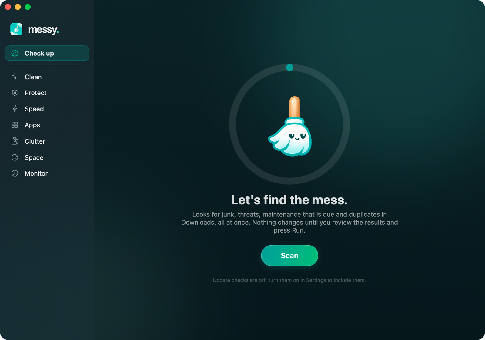
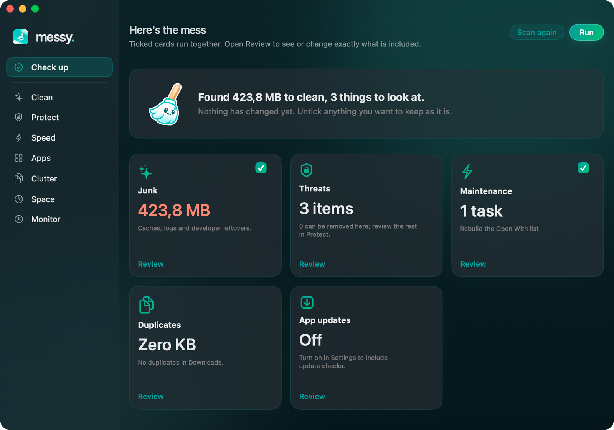
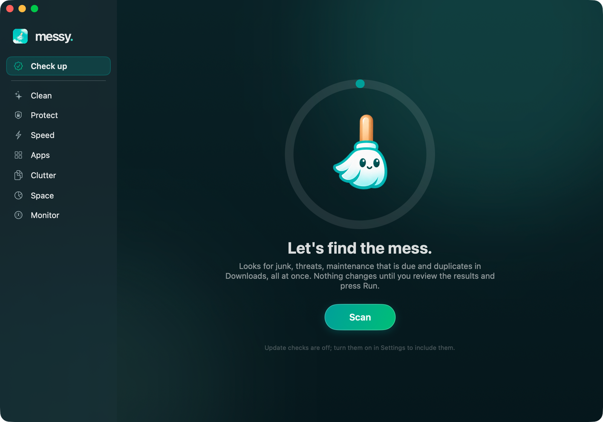
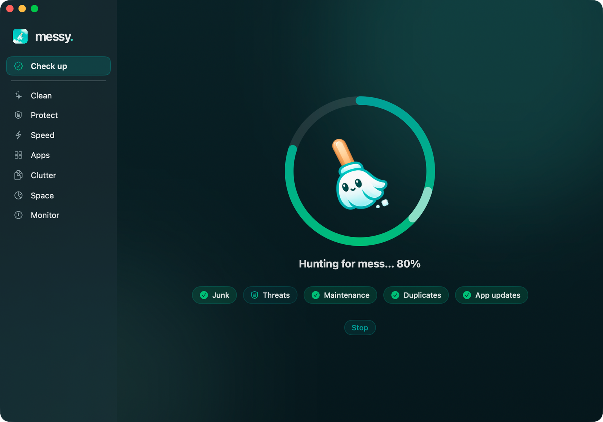
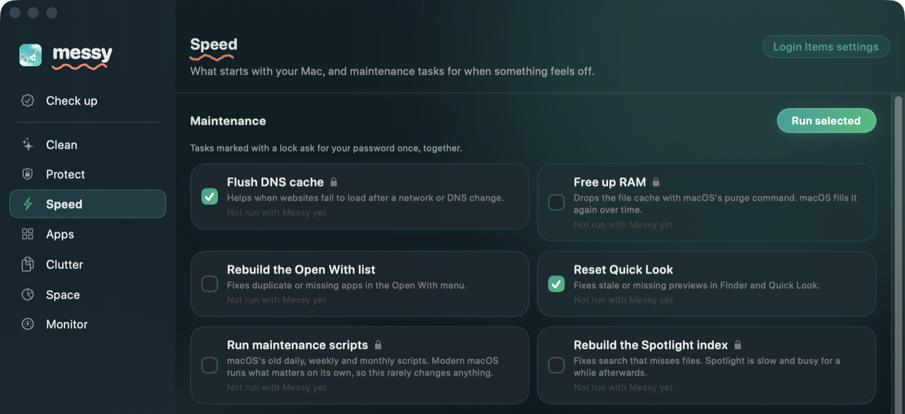

<p align="center"></p>

# Messy

A free, open-source Mac maintenance app: a one-button check up, cleaning, an uninstaller and update checker, duplicate and large-file finder, a disk map, a system monitor in the menu bar, and a check for cracked apps and suspicious background services. Messy finds the mess so you don't have to.

**[Download Messy](https://github.com/berkboz/messy/releases/latest/download/Messy.dmg)** · Apple Silicon & Intel · macOS 14+ · signed and notarized · [brk.bz/messy](https://brk.bz/messy/)

<p align="center"></p>

<table>
<tr>
<td></td>
<td></td>
</tr>
<tr>
<td></td>
<td></td>
</tr>
</table>

| Pane | What it does |
|---|---|
| **Check up** | One button scans for junk, threats, due maintenance and duplicates in Downloads, shows the results as cards, and runs only what you tick |
| **Clean** | App caches, logs, developer leftovers (Xcode, npm, bun, cargo, Gradle, pnpm), Mail attachments, old installers; Trash size and Empty Trash |
| **Protect** | A heuristic threat check (risky background services, tampered or re-signed apps, login hooks, cron jobs, `DYLD_` injection in shell profiles), SIP / Gatekeeper / FileVault / firewall status, every third-party background service, app signatures, open ports |
| **Speed** | What starts with your Mac (your own agents can be turned off and on), and maintenance tasks: flush DNS, free up RAM, rebuild the Open With list, reset Quick Look, maintenance scripts, rebuild Spotlight |
| **Apps** | Uninstall apps with their preferences, caches, containers and launch agents; check for updates (Sparkle, App Store, Homebrew) when you ask |
| **Clutter** | Large files you have not opened in months, and identical copies (size, then partial hash, then SHA-256; one copy is always kept) |
| **Space** | A map of what takes up space, with drill-down, plus a list view |
| **Monitor** | Health score, CPU and top CPU apps, memory with pressure, swap and top apps, battery health and cycles, network with a speed test, external disks; also in the menu bar |

Optional alerts: low disk, a full Trash, memory tight for five minutes, a weekly reminder, and an offer to remove the leftovers of an app you dragged to the Trash.

## Principles

- **Nothing is deleted by Messy itself.** Everything goes to the Trash. *Empty Trash* asks Finder to empty it, after you confirm.
- **No privileged helper.** No daemon and no root component. Admin tasks run fixed, built-in commands behind the macOS password dialog; anything else that needs admin rights is shown as a quoted command you can read and run yourself.
- **No network unless you click.** No account, telemetry or analytics. Checking for updates asks each app's own update server (it sees your IP address), and the speed test uses Apple's `networkQuality`; both only run when you ask. Signature checks may let macOS confirm notarization tickets with Apple.
- **Honest about limits.** No signature-based antivirus (macOS XProtect does that), and no chip temperatures, fan speeds or hung-app detection, which need private macOS interfaces.

## Quickstart

Prereqs: macOS 14+, Xcode Command Line Tools (`xcode-select --install`). No other dependencies; Sparkle is fetched by SwiftPM on first build.

```bash
git clone https://github.com/berkboz/messy.git && cd messy
./build.sh                      # build/Messy.app, universal, signed with your Developer ID if you have one
SIGN_IDENTITY="" ./build.sh     # ad-hoc signed build (what you want without a Developer ID)
open build/Messy.app
./test.sh                       # compiles the logic files with Tests/main.swift and runs the checks; must pass before a PR
```

`./release.sh` builds a notarized DMG and the Sparkle appcast; it needs a notarytool keychain profile (see the comment at the top of the script) and is maintainer-only.

## Where things live

| Path | What |
|---|---|
| `Sources/Messy/` | The app (SwiftUI): one file per pane (`Checkup`, `Clean`, `Clutter`, `Security`/`Threats`, `Speed`, `Uninstall`/`Updates`, `SpaceMap`, `Monitor`), plus `Theme.swift` / `DesignSystem.swift` (brand and controls) |
| `Resources/` | `Info.plist`, entitlements, app icon, mascot sprites, sounds |
| `Tests/main.swift` | Assertion-style checks run by `test.sh` (no XCTest) |
| `design/` | Icon, brand art, screenshots used in this README, sound-synthesis scripts |
| `videos/messy-launch/` | The launch video, a HyperFrames project with its own `AGENTS.md` |

## Access you need

Nothing for building, testing or contributing. Releasing needs the maintainer's Developer ID, notarytool profile and Sparkle key.

## Working with Claude Code / Codex

Agent rules are in `AGENTS.md`; the design language is in `DESIGN.md`.

## License

MIT
