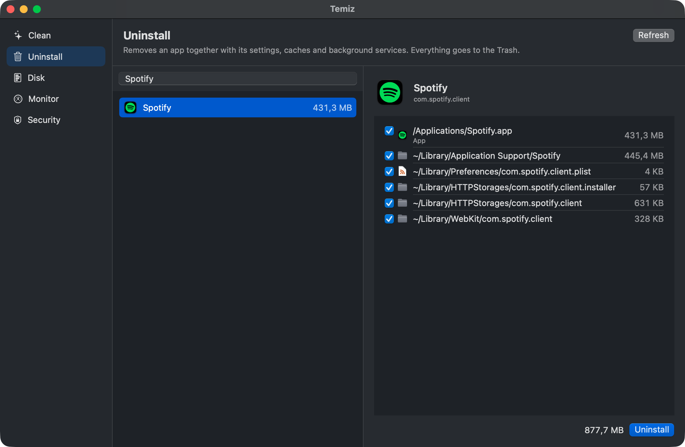

<p align="center"></p>

# Messy

A free, open-source Mac maintenance app: a one-button check up, cleaning, an uninstaller and update checker, duplicate and large-file finder, a disk map, a system monitor in the menu bar, and a check for cracked apps and suspicious background services. Messy finds the mess so you don't have to.

**[Download Messy](https://github.com/berkboz/messy/releases/latest/download/Messy.dmg)** · Apple Silicon & Intel · macOS 14+ · signed and notarized · [brk.bz/messy](https://brk.bz/messy/)



| Pane | What it does |
|---|---|
| **Check up** | One button scans for junk, threats, due maintenance and duplicates in Downloads, shows the results as cards, and runs only what you tick |
| **Clean** | App caches, logs, developer leftovers (Xcode, npm, bun, cargo, Gradle, pnpm), Mail attachments, old installers; Trash size and Empty Trash |
| **Protect** | A heuristic threat check (risky background services, tampered or re-signed apps, login hooks, cron jobs, `DYLD_` injection in shell profiles), SIP / Gatekeeper / FileVault / firewall status, every third-party background service, app signatures, open ports |
| **Speed** | What starts with your Mac (your own agents can be turned off and on), and maintenance tasks: flush DNS, free up RAM, rebuild the Open With list, reset Quick Look, maintenance scripts, rebuild Spotlight |
| **Apps** | Uninstall apps with their preferences, caches, containers and launch agents; check for updates (Sparkle, App Store, Homebrew) when you ask |
| **Clutter** | Large files you have not opened in months, and identical copies (size, then partial hash, then SHA-256; one copy is always kept) |
| **Space** | A map of what takes up space, with drill-down, plus a list view |
| **Monitor** | Health score, CPU and top CPU apps, memory with pressure, swap and top apps, battery health and cycles, network with a speed test, external disks; also in the menu bar |

Optional alerts: low disk, a full Trash, memory tight for five minutes, a weekly reminder, and an offer to remove the leftovers of an app you dragged to the Trash.

## Principles

- **Nothing is deleted by Messy itself.** Everything goes to the Trash. *Empty Trash* asks Finder to empty it, after you confirm.
- **No privileged helper.** No daemon and no root component. Admin tasks run fixed, built-in commands behind the macOS password dialog; anything else that needs admin rights is shown as a quoted command you can read and run yourself.
- **No network unless you click.** No account, telemetry or analytics. Checking for updates asks each app's own update server (it sees your IP address), and the speed test uses Apple's `networkQuality`; both only run when you ask. Signature checks may let macOS confirm notarization tickets with Apple.
- **Honest about limits.** No signature-based antivirus (macOS XProtect does that), and no chip temperatures, fan speeds or hung-app detection, which need private macOS interfaces.

## Build

Needs only the Xcode Command Line Tools.

```bash
./build.sh          # build/Messy.app, universal, signed with your Developer ID if you have one
open build/Messy.app
```

`SIGN_IDENTITY="" ./build.sh` makes an ad-hoc signed build, `./test.sh` runs the checks in `Tests/`, and `./release.sh` builds a notarized DMG; it needs a notarytool keychain profile (see the comment at the top of the script).

## License

MIT
